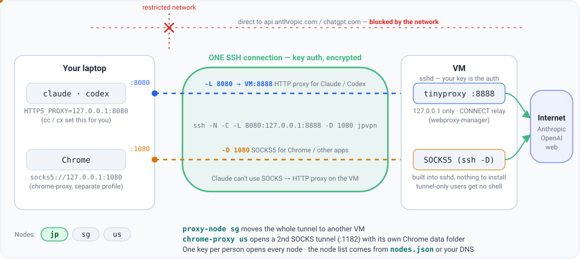

# 🔧 How it works

*This page gives background data for admins and for users who want to know more. To use the setup, refer to the **[Home page](https://claude-guide.vercel.app/)**.*

**How the traffic moves when the setup runs.** The diagram is animated. The packets move along the two forwards. The red line shows what occurs without the tunnel:



After the setup, type **`cc`** (Claude) or **`cx`** (Codex). The profile does all the steps automatically.

> **One tunnel, two forwards.** One SSH connection carries the two forwards:
> - **`-L 8080 → VM:8888`**: an HTTP proxy for **Claude and Codex**. [Claude Code does not support SOCKS proxies](https://code.claude.com/docs/en/network-config.md). Thus the HTTP proxy runs on the VM. Install it with [`webproxy-manager`](https://github.com/crayonluffy/forge/tree/main/webproxy-manager).
> - **`-D 1080`**: a **SOCKS5** proxy for **Chrome** and other applications (all traffic, and DNS on the VM).

## ❓ Why is there a proxy (tinyproxy) on the VM?

Claude Code uses only the **HTTP proxy protocol**. `HTTPS_PROXY=socks5://…` does not work. SSH cannot be an HTTP proxy: `-D` uses only SOCKS, and `-L` only connects one port to one destination. Thus an HTTP proxy must run in one of two locations:

| | Location of the HTTP proxy | Your computer runs | The VM runs |
|---|---|---|---|
| **A: current** | On the VM (tinyproxy, port `8888`) | Only `ssh` | tinyproxy (you install it one time) |
| **B: old** | On your computer (an `npx http-proxy-to-socks` bridge over `-D 1080`) | `ssh` **and a Node bridge process** | Nothing |

The setup uses A **or** B, not the two. With tinyproxy, there is **no npx bridge**. `ssh -L 8080:127.0.0.1:8888` makes tinyproxy on the VM available at `127.0.0.1:8080` on your computer. Claude and Codex send their HTTP proxy requests directly to it.

This guide used design B before. It [changed to A](upgrading.md), because the bridge on the computer was the weak part. Node processes stayed after a stop, and `npx` did not start on Windows. The `-D 1080` forward is only for `chrome-proxy`. Claude and Codex do not use it.

## 🔐 Security: how the login works

The proxy has no username or password. **Your SSH key is the login.** Nothing is open to the internet:

- tinyproxy listens on `127.0.0.1:8888` **on the VM**. The internet cannot connect to it. The only access is through a tunnel with an SSH login.
- `127.0.0.1:8080` on your computer is a loopback address. Only processes on your own computer can use it, and only while your tunnel is up.
- tinyproxy only passes on `CONNECT` traffic. TLS stays end-to-end, so the proxy cannot read your API tokens or your conversations.
- The profile gets the list of VMs **privately over SSH** (`proxy-nodes --from <vm>`). It does not publish data about your servers.

> **Caution:** On a computer that **more users share**, other local users can use your `127.0.0.1:8080` while the tunnel is up. On a personal computer, this is not a problem.

## 🛑 The kill switch

The kill switch (on by default) keeps Claude and Codex from connecting directly from your computer:

- The profile keeps the proxy in Claude's `~/.claude/settings.json`. Claude reads this file before the settings of your terminal. When the tunnel is down, Claude cannot connect. It does not connect directly.
- Before each `cc` or `cx`, the profile makes sure that `NO_PROXY` does not exempt an API host. It also makes sure that only the tunnel uses the proxy port.
- The profile does not move the tunnel to a different port.

The kill switch protects Claude Code (the CLI and the IDE extensions) and Codex that you start with `cx`. It does not protect the Claude Desktop app, browsers or other applications. Refer to [Kill switch](proxy-profile.md#kill-switch-290).

## 🧩 What the installer does

| Step | What occurs |
|---|---|
| SSH key | The installer copies the key to `~/.ssh` and locks it (only you can read it). |
| SSH alias | The installer writes `jpvpn` in `~/.ssh/config`. Then `ssh jpvpn` works. |
| Profile | The installer adds `cc`, `cx`, `proxy-*`, `chrome-proxy`, `cc-install` … to each new window. The settings are in `~/.claude-proxy.conf` or `~\.claude-proxy.conf.psd1`. |
| Kill switch | The installer sets the kill switch on. It asks if plain `claude` and `codex` must also start through the proxy. |
| Node list | The installer gets the list from your VM over SSH, if your admin installed it ([Nodes](proxy-nodes.md)). |
| Tools | `cc-install` installs Node.js (LTS: winget or the official installer on Windows, Homebrew or the official package on macOS, nvm or NodeSource on Linux). Then it installs Claude Code and Codex with npm. All downloads go through the proxy. |

## Daily commands (full list)

```bash
cc              # proxy ON + start Claude   (cc-safe keeps the permission prompts)
cc -c           # ...and continue the last session (cc -r: select one; all claude flags go through)
cx              # proxy ON + start Codex    (cx-safe keeps the approval prompts)
proxy-up        # proxy ON, start nothing
cc-stop         # proxy OFF for both (also the Chrome tunnels of each node)
proxy-status    # what runs + your external IP
proxy-doctor    # a problem? it tells you the cause and the fix
proxy-killswitch  # the kill switch status (on / off)
proxy-update    # get the newest profile; your settings (proxy-config) stay
cc-install      # examine / install / update Node.js, Claude Code and Codex  (--check: report only)

proxy-nodes     # the nodes (jp / jp2 / sg / us …) and the node that you use
cc --node sg    # Claude through node sg, in this terminal only   (also cx --node sg)
proxy-node sg   # make sg the default node for new terminals
chrome-proxy us # a Chrome window through 'us': its own tunnel and profile; other nodes stay open
chrome-proxy jp --profile work   # a different Chrome profile through the same node (chrome-profiles shows them)
proxy-nodes --from jpvpn         # get the node list privately from one of your VMs (over SSH)
```

For each command and setting, refer to **[All commands](proxy-profile.md)**.
