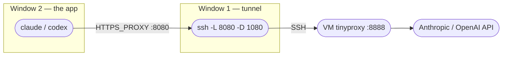

# Proxy — Manual (no profile)

This page shows how to run the proxy **by hand**, without the profile in your shell. These are the same steps that `cc` and `cx` do automatically. Use this page if you do not want the profile, or to find which part of the setup has a problem.

**How it works: you keep 2 windows open.**



- **Window 1** keeps the SSH tunnel open all the time.
- **Window 2** gets the proxy settings, then runs Claude or Codex.

## Before you start: checklist

- [ ] **The SSH key and the `jpvpn` alias are installed.** If not, do [Proxy setup → Step 1](proxy-profile.md) (with the wizard or by hand).
- [ ] **The proxy on the VM runs.** The VM must run [`webproxy-manager`](https://github.com/crayonluffy/forge/tree/main/webproxy-manager) (tinyproxy on `127.0.0.1:8888`). If you do not know, ask your admin.
- [ ] **[Claude Code](install-claude.md) or [Codex](install-codex.md) is installed.** You can also install them **after** steps 1–3. On a blocked network, their sign-in (and sometimes `npm install`) works only when the proxy is up.
- [ ] **The host key is accepted.** Type `ssh jpvpn` one time, type `yes`, then exit. (Do this the first time only.)

---

## 🪟 Windows (PowerShell)

### Step 1: Open the tunnel (window 1, keep it open)

```powershell
# -L 8080 -> the VM's HTTP proxy (Claude/Codex); -D 1080 -> SOCKS5 (Chrome)
ssh jpvpn -N -C -L 8080:127.0.0.1:8888 -D 1080
```

**✅ Check:** the command shows nothing and does not stop. **This is correct.** `-N` means "no remote shell, only forward the ports". Keep this window open. If the command stops at once or shows an error, refer to [The procedure did not work?](#the-procedure-did-not-work).

### Step 2: Set the proxy settings (window 2, a NEW window)

```powershell
$env:http_proxy="http://127.0.0.1:8080"
$env:HTTP_PROXY="http://127.0.0.1:8080"
$env:https_proxy="http://127.0.0.1:8080"
$env:HTTPS_PROXY="http://127.0.0.1:8080"
```

These settings apply only to **this** window. No other program on your computer uses the proxy.

### Step 3: Make sure that the proxy carries your traffic

```powershell
curl.exe ipinfo.io
```

**✅ Check:** the `ip` must be the IP address of the **VM**, not your own. If it is your own IP address, the settings are not in this window. Do step 2 again in the same window.

### Step 4: Start Claude or Codex (same window)

```powershell
# Claude (does not ask for permission):
claude --dangerously-skip-permissions
# ...or with the prompts:  claude
```

```powershell
# Codex (does not ask for approval):
codex --dangerously-bypass-approvals-and-sandbox
# ...or with the prompts:  codex
```

### Step 5: When you are done

- **Window 1:** push `Ctrl+C` to close the tunnel.
- **Window 2:** close the window. The proxy settings stop with the window.

---

## 🍎 macOS / 🐧 Linux / WSL (bash or zsh)

### Step 1: Open the tunnel (terminal 1, keep it open)

```bash
# -L 8080 -> the VM's HTTP proxy (Claude/Codex); -D 1080 -> SOCKS5 (Chrome)
ssh jpvpn -N -C -L 8080:127.0.0.1:8888 -D 1080
```

If you do not have the `jpvpn` alias, write the full command:

```bash
ssh -i ~/.ssh/<your-key> -N -C -L 8080:127.0.0.1:8888 -D 1080 <your-ssh-user>@<your-host>
```

**✅ Check:** the command shows nothing and does not stop. **This is correct.** `-N` means "no remote shell, only forward the ports". Keep this terminal open. If the command stops at once or shows an error, refer to [The procedure did not work?](#the-procedure-did-not-work).

### Step 2: Set the proxy settings (terminal 2, a NEW terminal)

```bash
export http_proxy=http://127.0.0.1:8080
export HTTP_PROXY=http://127.0.0.1:8080
export https_proxy=http://127.0.0.1:8080
export HTTPS_PROXY=http://127.0.0.1:8080
export NO_PROXY="localhost,127.0.0.1"   # add your company intranet ranges here if necessary
```

These settings apply only to **this** terminal. No other program on your computer uses the proxy.

### Step 3: Make sure that the proxy carries your traffic

```bash
curl ipinfo.io
```

**✅ Check:** the `ip` must be the IP address of the **VM**, not your own. If it is your own IP address, the settings are not in this terminal. Do step 2 again in the same terminal.

### Step 4: Start Claude or Codex (same terminal)

```bash
# Claude (does not ask for permission):
claude --dangerously-skip-permissions
# ...or with the prompts:  claude
```

```bash
# Codex (does not ask for approval):
codex --dangerously-bypass-approvals-and-sandbox
# ...or with the prompts:  codex
```

### Step 5: When you are done

- **Terminal 1:** push `Ctrl+C` to close the tunnel.
- **Terminal 2:** close the terminal. Or type `unset http_proxy HTTP_PROXY https_proxy HTTPS_PROXY NO_PROXY` to use it without the proxy.

> **Note:** If the profile is also installed and its kill switch is on, Claude's `settings.json` keeps `http://127.0.0.1:8080`. Then plain `claude` also uses this manual tunnel, and it cannot connect when the tunnel is closed.

---

## 🌐 (Optional) Browse through the proxy (Chrome)

> To open Chrome windows through **more regions at the same time** (JP + SG + US), refer to [Nodes → manual equivalent](proxy-nodes.md#no-profile-the-manual-equivalent). You need one more `ssh -D` for each region on its own port, and a different `--user-data-dir` for each window.

The tunnel from step 1 already has a **SOCKS5** forward on `127.0.0.1:1080` (the `-D 1080` part). These commands open a **separate** Chrome through it. It has its own profile, and its DNS goes through the tunnel. Your normal browser does not change. Use it when a sign-in page (Anthropic or OpenAI) does not open in your normal browser.

**🪟 Windows (PowerShell)**

```powershell
& "C:\Program Files\Google\Chrome\Application\chrome.exe" `
    --proxy-server="socks5://127.0.0.1:1080" `
    --host-resolver-rules="MAP * ~NOTFOUND , EXCLUDE 127.0.0.1" `
    --user-data-dir="C:\ChromeVPNProfile" --no-first-run
```

**🍎 macOS**

```bash
open -n -a "Google Chrome" --args \
    --proxy-server="socks5://127.0.0.1:1080" \
    --host-resolver-rules="MAP * ~NOTFOUND , EXCLUDE 127.0.0.1" \
    --user-data-dir="$HOME/.chrome-proxy-profile" --no-first-run
```

**🐧 Linux** (if you do not have `google-chrome`, use `chromium`)

```bash
google-chrome \
    --proxy-server="socks5://127.0.0.1:1080" \
    --host-resolver-rules="MAP * ~NOTFOUND , EXCLUDE 127.0.0.1" \
    --user-data-dir="$HOME/.config/google-chrome-vpn" --no-first-run &
```

**🐧 WSL:** use the **Windows PowerShell** command. WSL2 forwards `127.0.0.1:1080` to Windows automatically.

---

## The procedure did not work?

| Symptom | Possible cause and fix |
|---------|------------------------|
| Step 1 asks `Are you sure you want to continue connecting?` | Type `yes`. This occurs only at the first connection. A tunnel in the background cannot answer. Thus type `ssh jpvpn` one time first. |
| Step 1 stops at once with `bind: Address already in use` | A different program (for example an old tunnel) uses port 8080 or 1080. Close it. If the profile is installed, type `cc-stop`. |
| Step 1 asks for a passphrase each time | Add the key to your agent or Keychain. Refer to [Troubleshooting](troubleshooting.md). |
| Step 3 shows **your own** IP address | The proxy settings are not in this window (each window needs step 2). Or the tunnel is not up (look at window 1). |
| Step 3 does not stop, or shows a timeout | The tunnel is up, but the proxy on the VM is not. Make sure that the VM runs `webproxy-manager` (tinyproxy on port `8888`). |
| Claude or Codex cannot connect to the API | Make sure that `NO_PROXY` does **not** contain `api.anthropic.com`. Refer to [Troubleshooting](troubleshooting.md). |

For more conditions, refer to **[Troubleshooting](troubleshooting.md)**.

> **Tip:** If you do this often, use the [one-command profile setup](proxy-profile.md). `cc` and `cx` do all five steps, and `proxy-doctor` examines each part automatically.
